# Dress Up: what stands in each place

The formal list of every place's objects (ticket 99), as of 0.0.198, at the default settings, each with its picture (ticket 180). A slider that adds things (more toys, more ducks, more chairs) adds objects.

- **Depth** is the y where a thing stands on the ground, in the stage's units: the ground line is at 320, and the friend's feet can be anywhere from about 11 (far) to 406 (near).
- The friend is drawn behind every object deeper than their feet, and in front of the rest. **front** means in front of everything: the friend is always under it (darkness, light, steam, the sign toward us).
- Flat things on the ground and the backdrop (sky, far hills, back walls and what hangs on them) are not objects.
- In the game each place shows this list in its background tab, with an 👁️ chip per object to hide or show it.
- **The pictures:** each place as it starts, the friend hidden and its animations held still; each object clipped from that picture by its box on the screen, so what stands near it shows too. Drawn by GitHub's headless Chrome.

Made by `tools/checks/objects180.mjs` (on GitHub's computers: push a branch carrying it) and `tools/objects_md.py`. Make it again after changing what stands in a place.

## 🔲 empty room

(0.0.77, ticket 153.) Nothing stands here: the friend is in front of everything. Its back wall is solid, as the imagination's is.

## 🫧 bubble space

| depth | object | picture |
|---:|---|---|
| front | bubbles |  |

## 💭 our imagination

(0.0.75, ticket 145: its ladders, one at each column's right, at the wall's foot. Its back wall is solid: the friend's feet stay at 271.5 or nearer.)

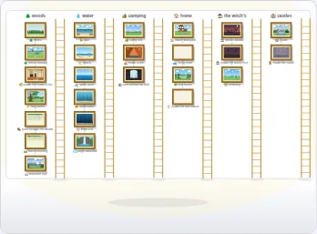

| depth | object | picture |
|---:|---|---|
| 268.5 | ladder 1 |  |
| 268.5 | ladder 2 |  |
| 268.5 | ladder 3 | 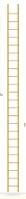 |
| 268.5 | ladder 4 | 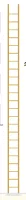 |
| 268.5 | ladder 5 |  |
| 268.5 | ladder 6 |  |

## 🌲 forest

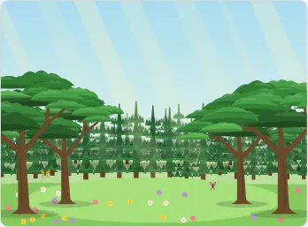

| depth | object | picture |
|---:|---|---|
| 234.1 | pines, far row | 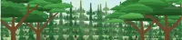 |
| 277.1 | pines, near row | 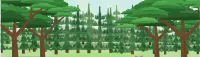 |
| 285.6 | butterflies | 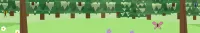 |
| 345.8 | big tree, left, inner | 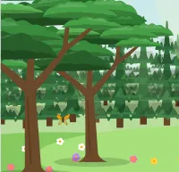 |
| 345.8 | big tree, right, inner | 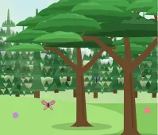 |
| 371.5 | big tree, left, outer | 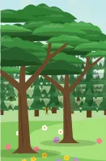 |
| 371.5 | big tree, right, outer | 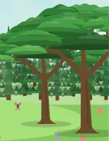 |
| front | way N | 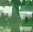 |
| front | way NE |  |
| front | way E | 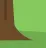 |
| front | way SE | 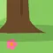 |
| front | way S |  |

## 🐠 underwater

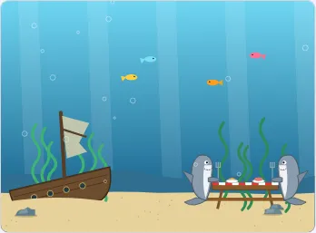

| depth | object | picture |
|---:|---|---|
| 259.9 | orange fish |  |
| 259.9 | yellow fish |  |
| 259.9 | pink fish |  |
| 259.9 | blue fish |  |
| 337.2 | seaweed, left | 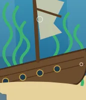 |
| 337.2 | seaweed, right | 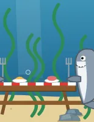 |
| 340.6 | rock, left 3 |  |
| 344.7 | rock, left 2 | 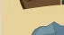 |
| 345.8 | shipwreck | 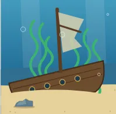 |
| 345.8 | picnic bench | 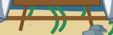 |
| 345.8 | shark, left | 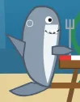 |
| 345.8 | shark, right | 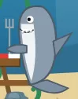 |
| 345.8 | picnic table | 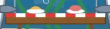 |
| 347.2 | rock, right 2 | 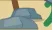 |
| 358.9 | rock, right 1 | 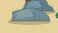 |
| 362.3 | rock, left 1 | 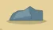 |
| front | bubbles | 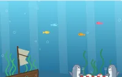 |

## 🪸 deep sea

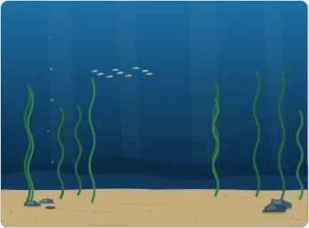

| depth | object | picture |
|---:|---|---|
| 238.4 | school of fish |  |
| 340.6 | kelp, left | 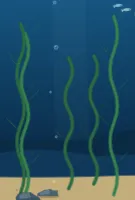 |
| 340.6 | kelp, right | 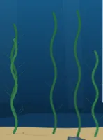 |
| 342 | rock, left 2 | 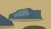 |
| 349.8 | rock, left 1 | 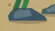 |
| 354.4 | vent | 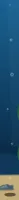 |
| 354.5 | rock, right 2 | 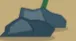 |
| 365.4 | rock, right 1 | 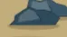 |
| front | way E | 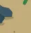 |
| front | way S |  |

## 🏖️ beach

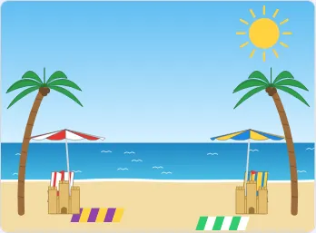

| depth | object | picture |
|---:|---|---|
| 328.6 | beach chair, left | 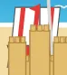 |
| 328.6 | beach chair, right | 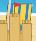 |
| 337.2 | umbrella, left | 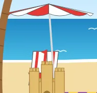 |
| 337.2 | umbrella, right | 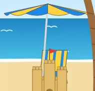 |
| 354.4 | palm tree, left |  |
| 354.4 | palm tree, right | 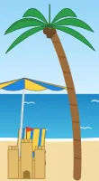 |
| 358.6 | sand castle, left | 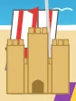 |
| 358.6 | sand castle, right | 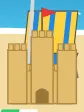 |
| front | way N |  |
| front | way NE | 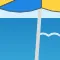 |
| front | way E |  |
| front | way SE | 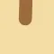 |
| front | way S |  |
| front | way SW | 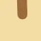 |
| front | way W |  |
| front | way NW |  |

## 🌊 open water

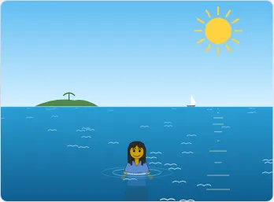

| depth | object | picture |
|---:|---|---|
| front | way E |  |
| front | way SE |  |
| front | way SW |  |
| front | way W |  |

## 🧙 witch's woods

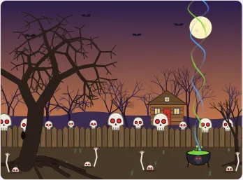

| depth | object | picture |
|---:|---|---|
| 212.6 | dead trees, far row | 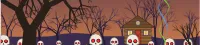 |
| 245.3 | dead trees, near row |  |
| 278.8 | hut |  |
| 297.7 | fence |  |
| 297.7 | skulls |  |
| 354.4 | giant tree |  |
| 354.4 | tree, right |  |
| 364.7 | skeleton, left |  |
| 367.2 | cauldron |  |
| 376.7 | skeleton, right |  |
| 380.1 | skeleton, right edge |  |
| 383.6 | skeleton, left edge |  |
| front | way E |  |
| front | way SE |  |
| front | way S |  |

## 🌿 cemetery

| depth | object | picture |
|---:|---|---|
| 242.7 | far trees |  |
| 259.9 | butterflies |  |
| 275.3 | far stones |  |
| 294.2 | yellow bush |  |
| 301.5 | willow |  |
| 318.3 | green bush |  |
| 323.4 | headstone, left |  |
| 325.2 | cross |  |
| 342.3 | headstone, right |  |
| 345.8 | stag stone |  |
| 345.8 | pink bush |  |
| 349.2 | white bush |  |
| front | way N |  |
| front | way NE |  |
| front | way E |  |
| front | way W |  |
| front | way NW |  |

## 🦆 lake

| depth | object | picture |
|---:|---|---|
| 105.3 | far wood |  |
| 125.8 | duck 1 |  |
| 142.9 | duck 5 |  |
| 167.2 | duck 3 |  |
| 192.6 | duck 2 |  |
| 198.8 | duck 4 |  |
| 264.2 | cattails, left |  |
| 264.2 | cattails, right |  |
| front | way N |  |
| front | way E |  |
| front | way SE |  |
| front | way S |  |
| front | way SW |  |
| front | way W |  |
| front | way NW |  |

## 🏠 house and yard

| depth | object | picture |
|---:|---|---|
| 169.7 | house |  |
| 186.9 | tree, left |  |
| 195.5 | tree, right |  |
| 217.9 | teddy |  |
| 220.1 | truck 2 |  |
| 232.3 | wagon |  |
| 233.2 | ball |  |
| 252.9 | blocks |  |
| 267 | truck |  |
| 268.5 | butterflies |  |
| 354.1 | ball 2 |  |
| 364.2 | bucket |  |
| front | way N |  |
| front | way NE |  |
| front | way E |  |
| front | way SE |  |
| front | way S |  |
| front | way SW |  |
| front | way W |  |
| front | way NW |  |

## 🌳 tree house

| depth | object | picture |
|---:|---|---|
| 214.4 | trees, far row |  |
| 268.5 | butterflies |  |
| 287.4 | trees, left |  |
| 287.4 | trees, right |  |
| 307.9 | bush, left 5 |  |
| 309.4 | bush, left 1 |  |
| 314.2 | bush, left 4 |  |
| 315.5 | bush, right 3 |  |
| 320 | tree house |  |
| 320.7 | bush, left 8 |  |
| 334.9 | bush, right 1 |  |
| 337.3 | bush, left 6 |  |
| 337.7 | bush, right 2 |  |
| 341.5 | bush, left 3 |  |
| 342.6 | bush, left 2 |  |
| 345.5 | bush, right 8 |  |
| 346.8 | bush, left 7 |  |
| front | way S |  |
| front | way SW |  |
| front | way W |  |

## 🛋️ living room

| depth | object | picture |
|---:|---|---|
| 242.7 | lamp |  |
| 259.9 | plant |  |
| 285.6 | couch |  |
| front | way S |  |

## 🧙 inside the witch's hut

| depth | object | picture |
|---:|---|---|
| 253 | snake tank |  |
| 277.1 | cauldron |  |
| 320 | witch |  |
| front | dark |  |

## 🌲 forest clearing

| depth | object | picture |
|---:|---|---|
| 136.2 | far woods |  |
| 204.9 | castle |  |
| 205.3 | tree house |  |
| 226.6 | house |  |
| 252.3 | witch hut |  |
| 271.2 | healer hut |  |
| 345.8 | butterflies |  |
| 354.4 | tree, left, outer |  |
| 354.4 | tree, right, outer |  |
| 388.7 | tree, left, inner |  |
| 388.7 | tree, right, inner |  |
| front | way N |  |
| front | way NE |  |
| front | way E |  |
| front | way SE |  |
| front | way S |  |
| front | way SW |  |
| front | way W |  |
| front | way NW |  |

## 🌿 inside the healer's hut

| depth | object | picture |
|---:|---|---|
| 234.1 | potion shelves |  |
| 234.1 | cat |  |
| 320 | soup pot |  |
| 320 | healer |  |
| 385.3 | tea table |  |
| 387 | chair, left |  |
| 387 | chair, right |  |
| 392.1 | worktable |  |
| front | warm light |  |

## 🧚 fairy forest

| depth | object | picture |
|---:|---|---|
| 196.3 | trees, far row |  |
| 230.7 | trees, near row |  |
| 316.8 | toadstool 11 |  |
| 317.5 | toadstool 12 |  |
| 324 | toadstool 10 |  |
| 325.2 | bush |  |
| 325.4 | toadstool 13 |  |
| 333.6 | toadstool 9 |  |
| 337.2 | great tree |  |
| 337.2 | fairy house |  |
| 341.5 | toadstool 14 |  |
| 349.4 | toadstool 8 |  |
| 357.2 | toadstool 1 |  |
| 370.6 | toadstool 7 |  |
| 371.5 | stone, left |  |
| 371.7 | toadstool 2 |  |
| 382.7 | toadstool 6 |  |
| 386.7 | toadstool 3 |  |
| 390.7 | toadstool 5 |  |
| 391.7 | toadstool 4 |  |
| 397.3 | stone, right |  |
| front | sparkles |  |
| front | way N |  |
| front | way SW |  |
| front | way W |  |
| front | way NW |  |

## ⛰️ mountain trail

| depth | object | picture |
|---:|---|---|
| 191.2 | birds |  |
| 322.9 | pine, right 1 |  |
| 326.6 | pine, right 4 |  |
| 327.6 | pine, right 2 |  |
| 329.6 | rock, left 5 |  |
| 330.2 | pine, left 2 |  |
| 334 | pine, left 3 |  |
| 338.2 | rock, left 2 |  |
| 338.9 | pine, right 3 |  |
| 339.1 | pine, left 1 |  |
| 344.1 | pine, left 4 |  |
| 349.1 | rock, right 4 |  |
| 351 | rock, left 4 |  |
| 351.7 | rock, left 1 |  |
| 355.9 | rock, left 3 |  |
| 364.1 | rock, right 2 |  |
| 364.7 | rock, right 3 |  |
| 369.1 | rock, right 1 |  |
| front | way E |  |
| front | way SE |  |
| front | way S |  |
| front | way SW |  |
| front | way W |  |

## 💦 jungle waterfall

| depth | object | picture |
|---:|---|---|
| 259.9 | mist |  |
| 259.9 | vines |  |
| 371.5 | jungle tree, left |  |
| 371.5 | jungle tree, right |  |
| 371.5 | parrot 1 |  |
| 371.5 | parrot 2 |  |
| front | way NE |  |
| front | way E |  |
| front | way SE |  |
| front | way S |  |

## 🏕️ camp site

| depth | object | picture |
|---:|---|---|
| 238.4 | woods |  |
| 285.6 | orange tent |  |
| 290.8 | blue tent |  |
| 354.4 | campfire |  |
| 392.1 | log, left |  |
| 392.1 | log, right |  |
| 452.3 | log, near |  |
| front | way N |  |
| front | way NE |  |
| front | way E |  |
| front | way SE |  |
| front | way S |  |
| front | way SW |  |
| front | way W |  |

## ⛺ inside a tent

| depth | object | picture |
|---:|---|---|
| 302.8 | flashlight beam |  |

## 🪨 cave behind the falls

| depth | object | picture |
|---:|---|---|
| 302.8 | big stalagmite, left |  |
| 302.8 | small stalagmite, left |  |
| 302.8 | big stalagmite, right |  |
| 302.8 | small stalagmite, right |  |
| 302.8 | stalactites |  |
| 302.8 | bats |  |
| 320 | chest |  |

## 🥾 path through the woods

| depth | object | picture |
|---:|---|---|
| 168.8 | far trees |  |
| 168.8 | sunbeams |  |
| 277.1 | butterflies |  |
| 337.2 | tree, left inner |  |
| 345.8 | tree, right inner |  |
| 350.9 | mushroom, right inner |  |
| 354.4 | mushroom, left inner |  |
| 371.5 | mushroom, right outer |  |
| 380.1 | tree, left outer |  |
| 380.1 | mushroom, left outer |  |
| 388.7 | tree, right outer |  |
| front | way N |  |
| front | way NE |  |
| front | way E |  |
| front | way S |  |
| front | way W |  |
| front | way NW |  |

## 🛤️ forest crossing

| depth | object | picture |
|---:|---|---|
| 57.2 | far trees |  |
| 57.2 | sunbeams |  |
| 277.1 | butterflies |  |
| front | way N |  |
| front | way E |  |
| front | way S |  |
| front | way W |  |

## 🏰 castle

| depth | object | picture |
|---:|---|---|
| 204.9 | trees, far row |  |
| 239.3 | trees, near row |  |
| 290.8 | castle |  |
| 290.8 | gate |  |
| 337.5 | well |  |
| 358.3 | hay cart |  |
| 370.2 | pennant, left |  |
| 370.2 | pennant, right |  |
| 371.5 | big tree, left, outer |  |
| 371.5 | big tree, right, outer |  |
| 372.3 | rock, left, inner |  |
| 376.7 | barrel, far |  |
| 379 | rock, right, outer |  |
| 383.6 | barrel, middle |  |
| 390.4 | rock, right, inner |  |
| 390.6 | rock, left, outer |  |
| 392.1 | barrel, near |  |
| 392.1 | crate |  |
| 414.5 | big tree, left, inner |  |
| 414.5 | big tree, right, inner |  |
| front | way S |  |
| front | way SW |  |
| front | way W |  |

## 🪜 tree house room 1

| depth | object | picture |
|---:|---|---|
| 225.5 | side doors |  |
| 231.7 | bunk beds |  |
| 237.5 | ladder up |  |
| 237.9 | toy chest |  |
| 250.3 | tree trunk |  |
| 271.9 | hatch |  |
| front | house sign |  |
| front | dark |  |

## 🪜 tree house room 2

| depth | object | picture |
|---:|---|---|
| 225.5 | side doors |  |
| 231.7 | counter |  |
| 231.7 | stove |  |
| 250.3 | tree trunk |  |
| 271.9 | hatch |  |
| 277.5 | table |  |
| front | house sign |  |
| front | dark |  |

## 🪜 tree house room 3

| depth | object | picture |
|---:|---|---|
| 225.5 | side doors |  |
| 237.9 | bookcase |  |
| 250.3 | tree trunk |  |
| 262.7 | beanbag |  |
| 271.9 | hatch |  |
| front | house sign |  |
| front | dark |  |

## 🪜 tree house room 4

| depth | object | picture |
|---:|---|---|
| 225.5 | side doors |  |
| 237.9 | telescope |  |
| 250.3 | tree trunk |  |
| front | house sign |  |
| front | dark |  |

## 🪜 tree house room 5

| depth | object | picture |
|---:|---|---|
| 237.5 | ladder up |  |
| 239.1 | paint table |  |
| 244.1 | easel |  |
| 250.3 | tree trunk |  |
| front | house sign |  |
| front | dark |  |

## 🪜 tree house room 6

| depth | object | picture |
|---:|---|---|
| 234.1 | drum kit |  |
| 237.5 | ladder up |  |
| 237.9 | keyboard |  |
| 250.3 | tree trunk |  |
| front | house sign |  |
| front | dark |  |

## 👑 king's room

| depth | object | picture |
|---:|---|---|
| 225.5 | throne |  |
| 225.5 | chandelier |  |
| 225.5 | armor, left |  |
| 225.5 | armor, right |  |
| 225.5 | door 2 |  |
| 225.5 | door 3 |  |
| 268.5 | chest of gold |  |
| front | way S |  |

## 🌿 greenhouse

| depth | object | picture |
|---:|---|---|
| 225.5 | parrots |  |
| 225.5 | arch to room 1 |  |
| 225.5 | arch to room 2 |  |
| 225.5 | arch to room 3 |  |
| 230.7 | ferns |  |
| 232.4 | bird of paradise, right |  |
| 234.1 | bird of paradise, left |  |
| 237.5 | monstera, left |  |
| 239.3 | monstera, right |  |
| 242.7 | palm, left |  |
| 251.3 | palm, right |  |
| 285.6 | hibiscus, left |  |
| 289.1 | hibiscus, right |  |
| 320 | fountain |  |
| 354.4 | bromeliad, left |  |
| 354.4 | bromeliad, right |  |
| 388.7 | watering can |  |

## 🕳️ trap room

| depth | object | picture |
|---:|---|---|
| 225.5 | way out |  |
| 285.6 | helmet |  |

## 🗝️ dungeon

| depth | object | picture |
|---:|---|---|
| 234.1 | ladder |  |
| 320 | bucket |  |
| 345.8 | rat |  |

## ⛓️ deep dungeon

| depth | object | picture |
|---:|---|---|
| 225.5 | cage |  |
| 234.1 | ladder |  |
| 235 | mushrooms |  |
| 297 | candle |  |
| 354.4 | cell |  |

## 🕯️ hallway

| depth | object | picture |
|---:|---|---|
| 225.5 | doors |  |

## 🐈 cat room

| depth | object | picture |
|---:|---|---|
| 225.5 | door 2 |  |
| 225.5 | door 3 |  |
| 228.8 | cat tree, left |  |
| 228.8 | cat tree, right |  |
| 228.8 | cat 2 |  |
| 228.8 | cat 5 |  |
| 231.4 | cat 3 |  |
| 241.6 | firewood |  |
| 241.6 | window seat |  |
| 241.6 | cat 4 |  |
| 254.1 | bowls |  |
| 258.7 | cat 1 |  |
| 282.5 | lantern |  |
| 282.5 | yarn, yellow |  |
| 295 | basket |  |
| 295 | cat 6 |  |
| 316.8 | toy mouse |  |
| 343 | yarn, red |  |
| 343 | rope bridge |  |
| 358.2 | box |  |
| 387.7 | yarn, green |  |
| front | way S |  |

## 🐴 stable

| depth | object | picture |
|---:|---|---|
| 225.5 | swallows |  |
| 225.5 | door 2 |  |
| 225.5 | door 3 |  |
| 227.2 | horse 1 |  |
| 227.2 | horse 2 |  |
| 227.2 | horse 3 |  |
| 251.9 | ladder |  |
| 266.1 | hen, brown |  |
| 279.6 | sunbeam |  |
| 295 | water trough |  |
| 295 | buckets |  |
| 295 | hen, white |  |
| 333.6 | hay heap |  |
| front | way S |  |

## 🍽️ dining room

| depth | object | picture |
|---:|---|---|
| 74.6 | chair, far end |  |
| 88.3 | chair, left 4 |  |
| 88.3 | chair, right 4 |  |
| 95.9 | candelabra 2 |  |
| 104.6 | chair, left 3 |  |
| 104.6 | chair, right 3 |  |
| 126.3 | chair, left 2 |  |
| 126.3 | chair, right 2 |  |
| 140.1 | candelabra 1 |  |
| 156.6 | chair, left 1 |  |
| 156.6 | chair, right 1 |  |
| 176.7 | table |  |
| 206.8 | chair, near end |  |
| 225.5 | doors |  |
| front | dark |  |
| front | fire light |  |
| front | torches |  |
| front | way S |  |

## 🍲 kitchen

| depth | object | picture |
|---:|---|---|
| 225.5 | oven |  |
| 225.5 | door 2 |  |
| 225.5 | door 3 |  |
| 228.8 | barrels |  |
| 228.8 | flour sack |  |
| 243.5 | cook, chopping |  |
| 256.4 | cauldron |  |
| 256.4 | cook, stirring |  |
| 266.1 | pots and pans |  |
| 333.6 | worktable |  |
| front | fire light |  |
| front | way S |  |

## ⚒️ smithy

| depth | object | picture |
|---:|---|---|
| 225.5 | forge |  |
| 225.5 | door 2 |  |
| 225.5 | door 3 |  |
| 234.1 | coal heap |  |
| 266.1 | anvil |  |
| 266.1 | smith |  |
| 316.8 | water barrel |  |
| front | dark |  |
| front | way S |  |

## 🌀 spiral staircase

| depth | object | picture |
|---:|---|---|
| 56.7 | door 3 |  |
| 148.8 | door 2 |  |
| 263.3 | column |  |
| 281.6 | steps |  |
| front | steps, in front |  |
| front | dark |  |
| front | way S |  |
